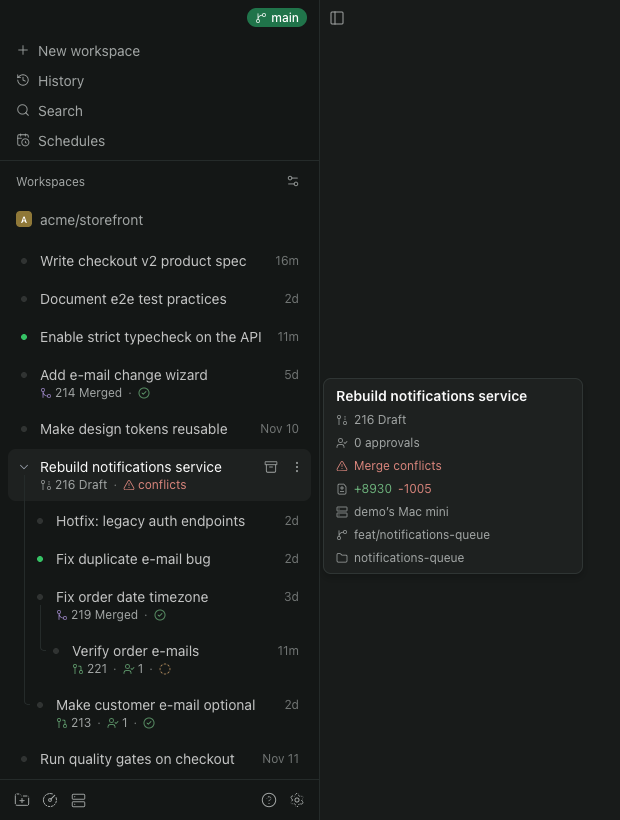
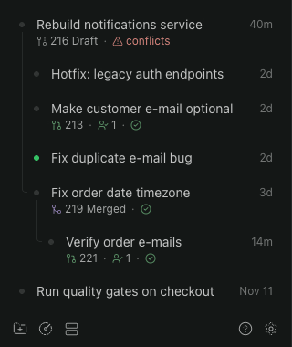
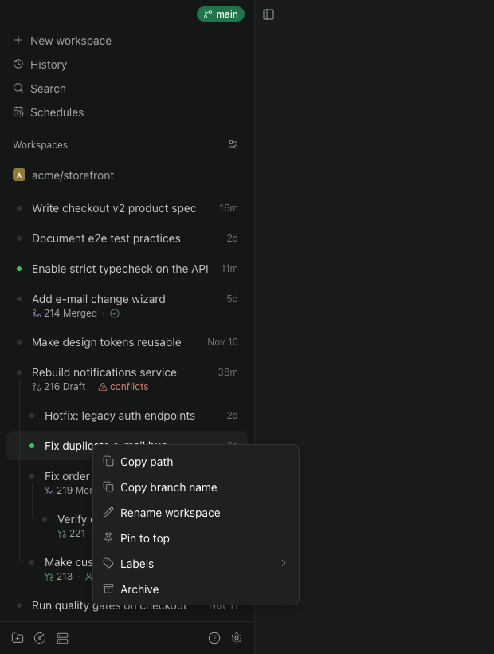

# Workspace relations for Paseo

A [Paseo](https://paseo.sh) plugin that adds a **Relations** sidebar view: Paseo's workspace sidebar,
with the workspaces an agent spawned nested under the workspace that spawned them, and richer pull
request status on every row.



## What it adds

- **Nested sub-agent workspaces.** A workspace created by another workspace's agent appears
  indented under it, as deep as the chain goes, joined by guide lines. Hover a parent and use its
  chevron to collapse its sub-agents.
- **Pull request details.** Rows show drafts as drafts, the number of approvals (`2/3` when the
  repository requires reviews), and merge conflicts. The hover card also says whether the pull
  request can merge. The default sidebar's rows get the same draft, approval and conflict details.
- **The default sidebar, otherwise.** Project grouping (or status grouping), status indicators,
  timestamps, checks, services, labels, "Show more", the Pinned section, the hover card, the "+" to
  start a workspace in a project, and the display preferences menu.
- **Drag to reorder.** Projects and pinned workspaces always; the workspaces in a project when Sort
  is Manual. Sub-agent workspaces reorder among their siblings, and a parent takes its sub-agents
  with it.
- **Workspace menu** from the ⋮ button or a right-click: copy path or branch, rename, pin, labels,
  archive.





## Install

```bash
paseo plugin add github:matheusAle/paseo-workspace-relations
```

Then choose **Settings → Sidebar → Sidebar view → Relations**.

Approval counts come from the `gh` (GitHub) or `glab` (GitLab) CLI, run in the workspace's
directory on the daemon host about once a minute while a pull request is open. Install and sign in
to the one your repositories use. The required approval count comes from branch protection, which
usually only repository admins can read; otherwise the row shows the approval count alone.

Requires Paseo 0.16.1 or later.

## Limitations

- Project icons show as letter avatars.
- The workspace menu has no Mark as read/unread or Open in file manager, and the project menu only
  has Open project settings (web) and Copy path. Plugins can't reach those app actions.
- The order you set here is kept on the device and separate from the default sidebar's. On web it
  starts from the default sidebar's order the first time the view loads.
- Other plugins' workspace row badges only render in the default sidebar view.

## Development

```bash
npm install
npm run typecheck
npm test
paseo plugin install "$PWD"          # once, from this directory
paseo plugin reload workspace-relations
```

After a reload, reload the app window to pick up client changes.
